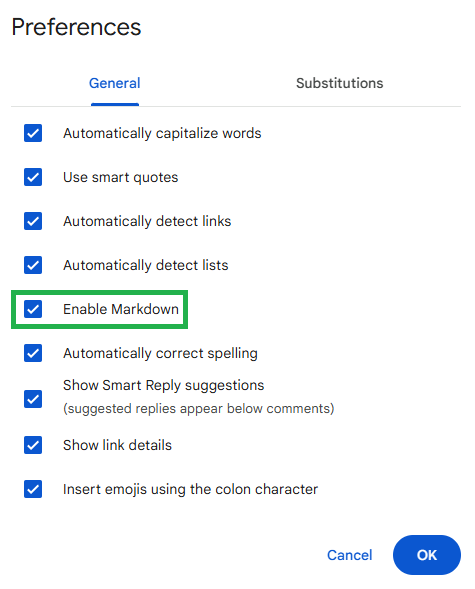
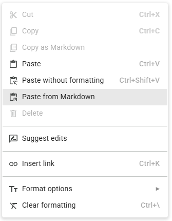
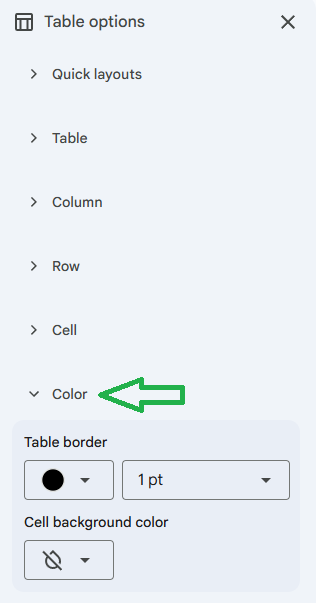

# Google Docs Cheat Sheet

### Enable Markdown

Navigate to `Tools > Preferences` and check "Enable Markdown."

### Paste from Markdown

To create a Google Doc from Markdown and preserve formatting, use the Paste from Markdown feature from a right mouse button click (or context click).

### Fix Markdown Table Border

For some Markdown tables, particularly those using HTML syntax, the borders may become invisible within the Google Doc. To rememedy, navigate to `Table Options` and open the Color collapsible panel. If not set, select Default as the color and 1 pt for the line width.

